# 从一个念头，到一本能读的书

平时打开 **http://127.0.0.1:8787**。如果还没启动书房，按 [README 的启动步骤](../README.md#启动书房8787) 操作。

这份指南的截图来自独立体验实例，使用 8788 和临时书稿；开书表单在截图之后又改过一次（去掉了 5/10 章，默认 50 章），以页面为准。你的日常书房仍用 8787；截图里的故事是验收样本。收尾截图标有“终稿恢复副本”：它没有新调用，截图中本书的 $0 不代表写作免费；本次五章原书记账约 $0.319（含未知用量估算）。

## 1. 打开书房

书库显示每本书的进度、字数和费用。点右上角“开新书”。查询页面不会重新调用模型；费用随实际生成累计。

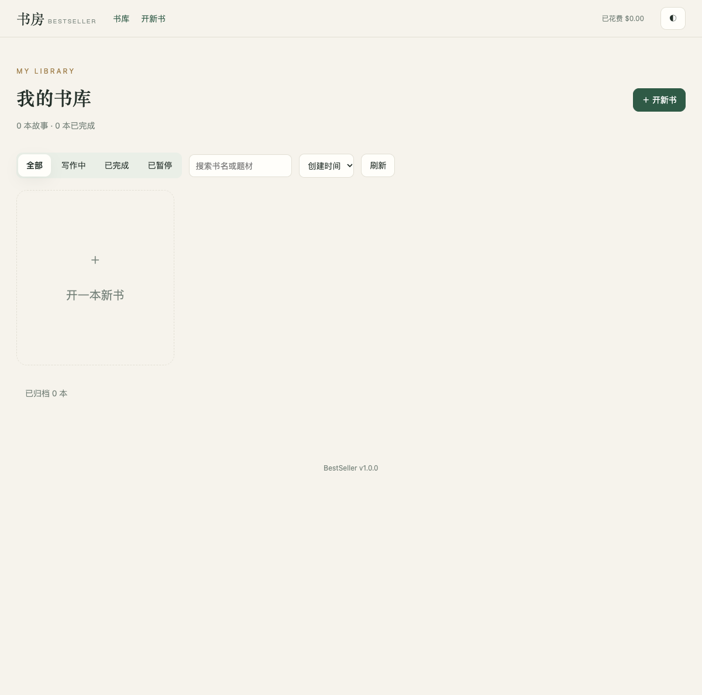

## 2. 给故事一个方向

选题材、频道和篇幅。篇幅默认 **50 章**，大约 1 小时左右写完、出齐终稿，约 $3；想先快速试一遍，可以选“自定章数”填 20。想法可留空，也可以填人物、愿望和一个具体矛盾。点“生成新选题”。

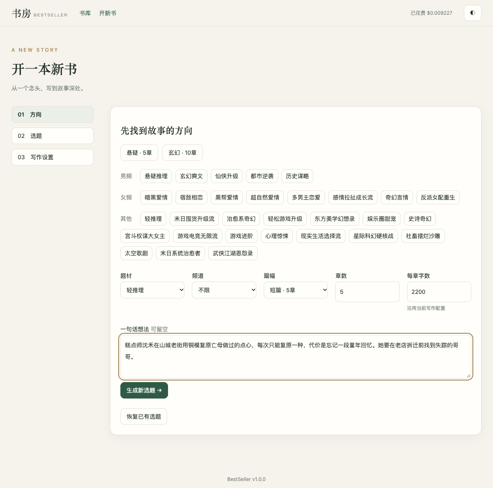

选题目标是在一分钟内先给你可选卡片。页面会显示“市场数据 → 构思第 N/4 组 → 筛选 → 排序”；先出现的卡片已经可以选择，其余卡片和参考分随后补充。遇到接口等待时可能超过一分钟，页面会显示重试状态；不要反复点击生成。

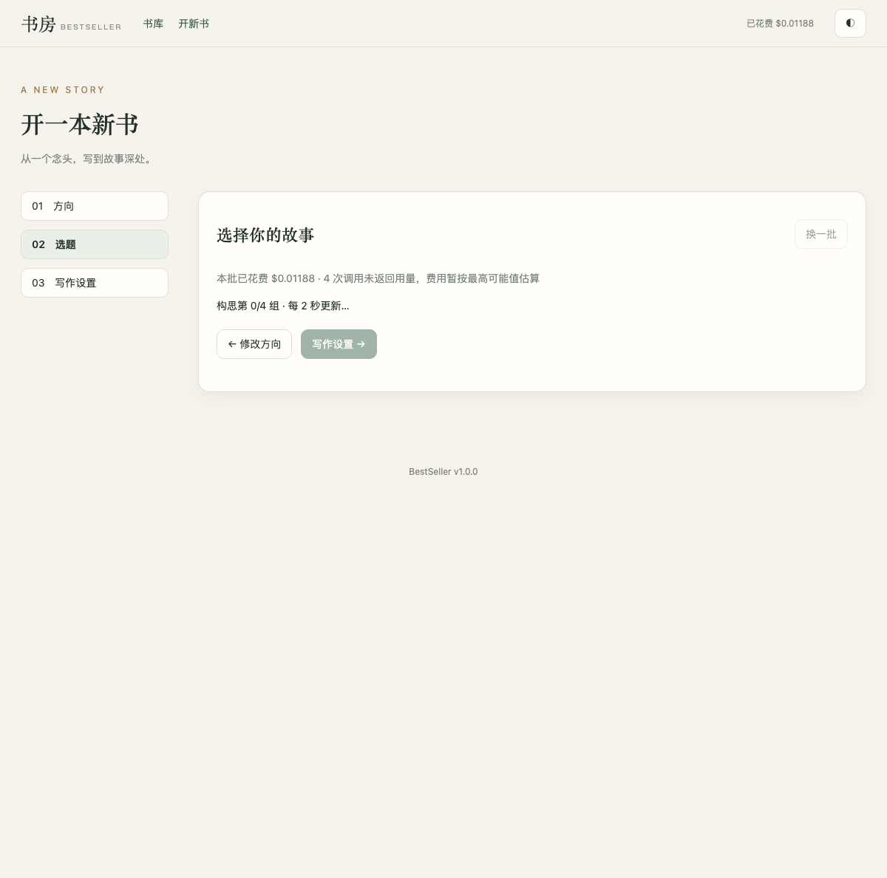

## 3. 选定你想读的故事

读书名、钩子、人物与冲突、金手指规则和开场画面。点卡片前的圆圈选中它。想改内容，可以展开“改一改”；确定后点“写作设置”。“换一批”会生成新批次并继续计费。旧批次可用“恢复已有选题”找回，无须重新付费生成。

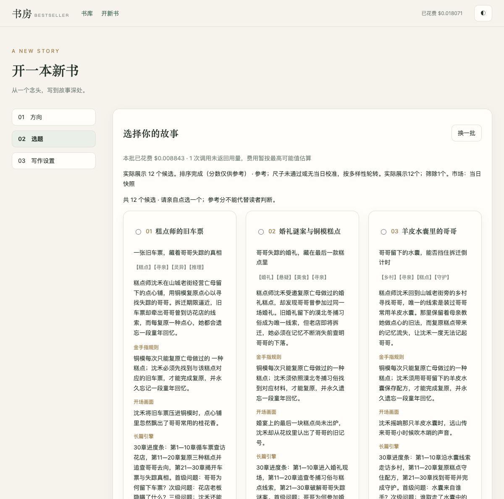

你的选择会保存在书里。书名、已有姓名、身份、场景、核心物件与规则、开场和方向轴只允许扩写。没有写姓名时，作者会在开书阶段起名。详情页的“你选的选题”供你与故事圣经对照。程序校验只能检查字段和关键词；是否忠实、好看，还需要你读。

## 4. 开始写作

写手选当前可用的 MiniMax Flash；模型显示不可用时，先检查启动目录的 `.env` 是否配置好。保持“自动去 AI”开启。并发书数是同时写几本书，单本书仍逐章写。点“以这个故事，开始写作”。

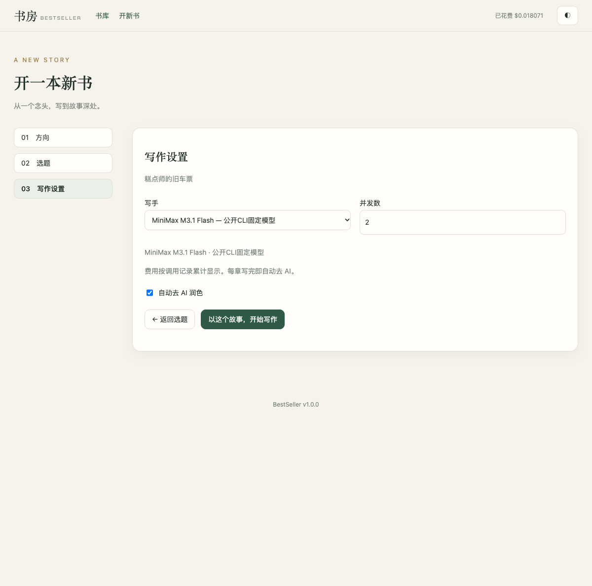

先生成故事圣经和排期，通常需要几分钟，然后开始正文。每章约 2200 汉字。一本五章书建议先留出 10–20 分钟；模型速度、重试和去 AI 阶段会改变等待时间，实际费用以页面记账为准。

1000 和 2000 章选项保留，但**尚未完整验证**。选择时会显示按已完成 50 章样本线性推算的时长和花费；不是承诺或预算上限。估算费用包含没有返回用量的请求上界，长篇和模型重试会带来偏差。第一次体验请先用短篇。

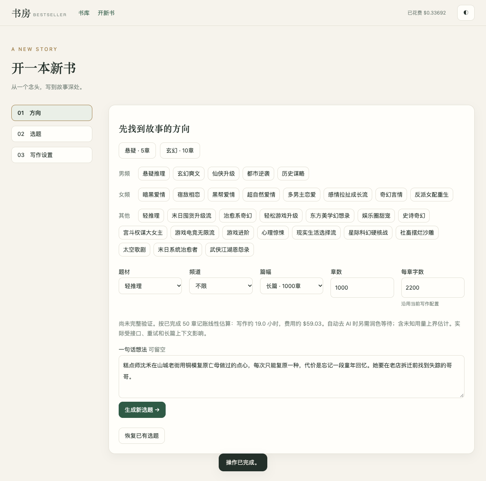

## 5. 写作中看什么

详情页每几秒更新。“终稿 N / 计划 M 章”统计已能阅读和导出的章节；正文进度可能领先终稿。每章写完并保存检查点后，去 AI 就可以接手，写手继续下一章。目录中的“正在去 AI”表示正文已写好，但该章终稿还没就绪。

展开“你选的选题”核对原卡；“故事圣经”“章纲”查看人物与规划；“检测报告（参考）”查看程序检查。已完成的终稿可以边写边读。

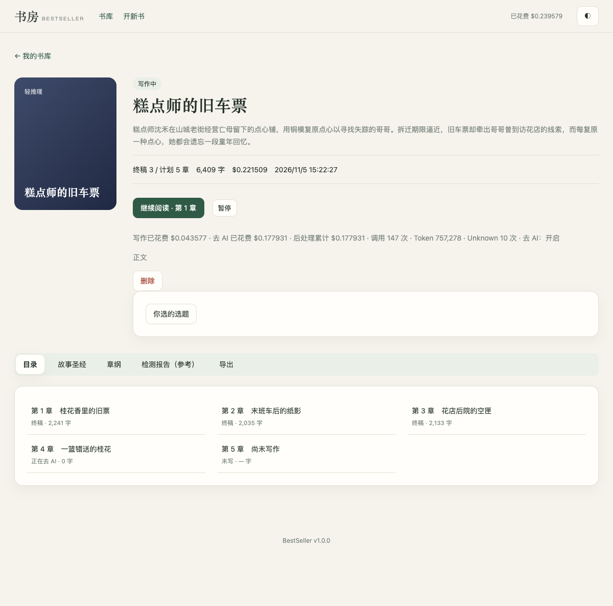

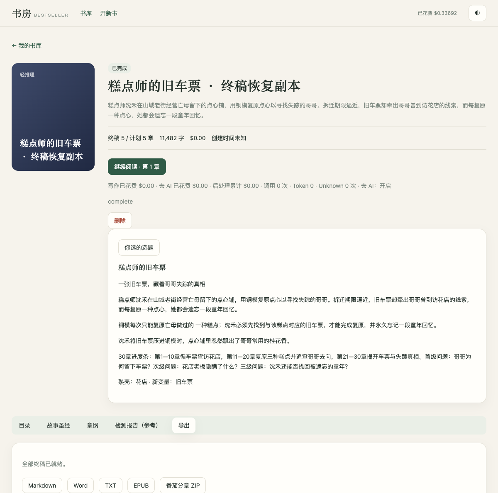

## 6. 读终稿，也能看修改对照

点“继续阅读”或目录里的章节。阅读器可调字号、行距和明暗主题，也可复制本章。

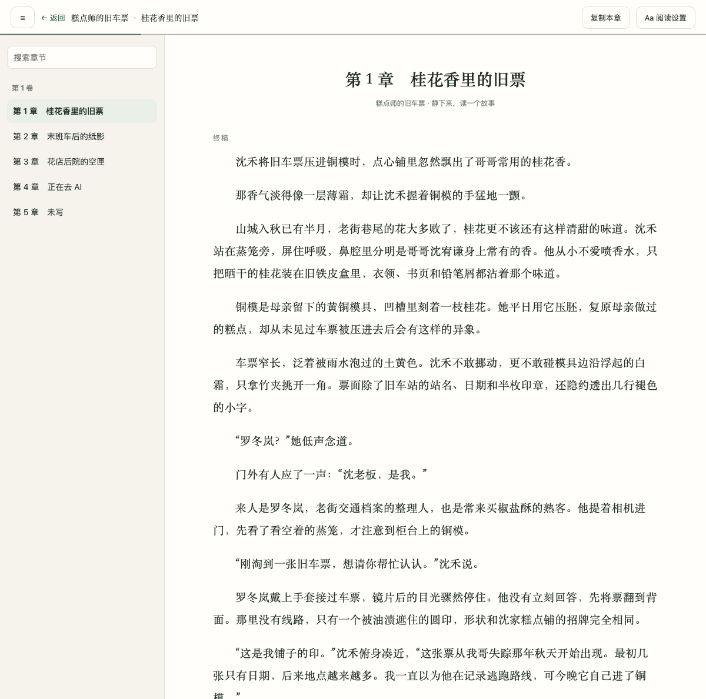

**只出终稿**：阅读和导出默认使用 `final/` 里已确定采用的版本。草稿不会混进缺失的终稿章节；尚缺的章会在导出说明中列出。阅读设置里的“查看修改对照”仍可看草稿和修改。

**去 AI 未完成用原稿**：如果没有可采用的修改、保真复检失败，或坏返回重试耗尽，本章会采用原稿作为终稿，并标出原因，后续章节继续。它表示回退有记录，不表示 AI 味已经解决。关闭自动去 AI 时，原稿会直接成为终稿。

## 7. 遇到等待或停止

| 页面状态 | 怎么处理 |
|---|---|
| 等待接口 | 限流、排队或网络问题会自动退避重试；看重试次数和下次时间。最长每十分钟试一次，没有总等待时限。保留页面或稍后回来，不必新开一本。 |
| 额度用尽 | 给模型账户充值后，在原书点“继续”。已有正文、终稿和调用记录保留。 |
| 出错 | 看错误阶段和摘要。配置或程序问题修好后，在原书点“重试”，从检查点接着跑。反复出同一错误时，把阶段和摘要交给维护者。 |

你也可以主动点“暂停”，以后点“继续”。写手和去 AI 分别保存状态；某一阶段等待或失败时，另一个阶段可能仍在运行。不要为了恢复而删除书目录。

## 8. 下载与整理

进入详情页“导出”，选 Markdown、Word、TXT、EPUB 或番茄分章 ZIP。五种格式都只导出已有终稿，建议等书库卡片显示“终稿 N / 计划 N 章”（两个数相等）后再下载全书。也可以“复制全书”；缺章时不会伪装成完整全书。

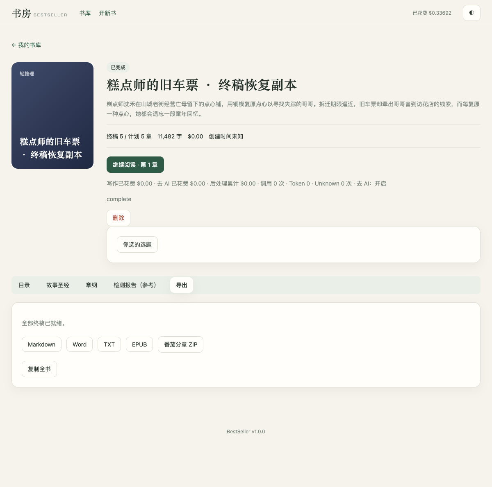

回到书库，每本书的菜单里可以重命名、归档或删除。归档会把书移到“已归档”，展开后可以恢复。删除需要一次确认；已完成或已暂停的书会先结束本书的去 AI 处理再删，正文还在写的书会拒绝删除。只想暂时收起来就用归档。费用与操作记录仍保留。

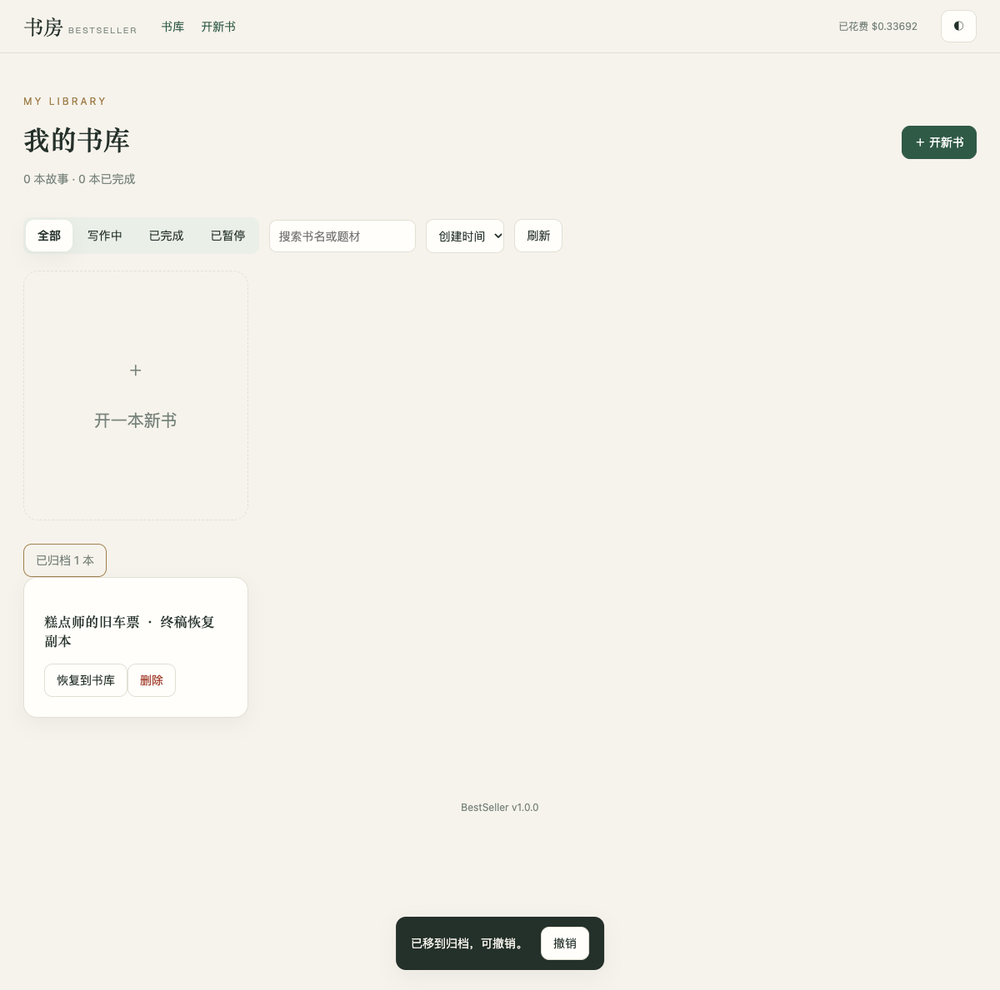

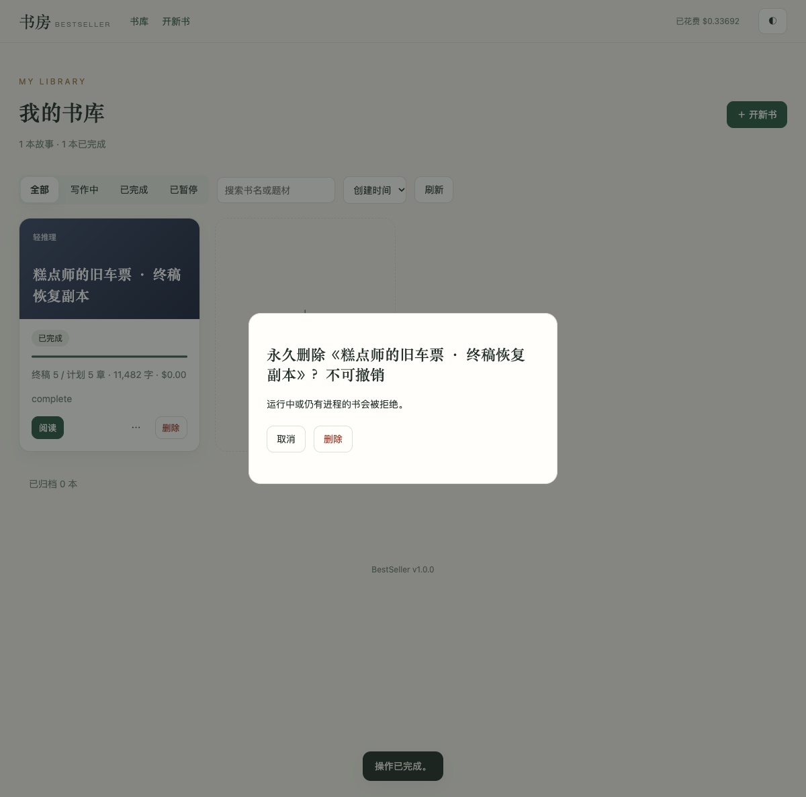

## 已知限制

- 目前去 AI 往往改得偏轻；保真回滚也可能让你读到原稿。第 31 条的去 AI 强度改进另行验收。
- 千章级选项尚未完整验证，线性估算不能证明实际跑完的时长或花费。
- 判官分、程序检测和字段匹配只作参考，不能代替你对人物、情节和可读性的判断。
